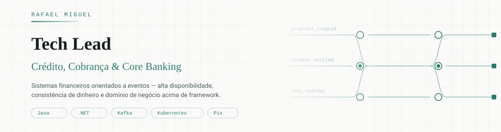

  
  
  

---

Sou **Tech Lead** especializado em **crédito, cobrança e meios de pagamento**. Construí carreira por domínio, não por empresa: motores de cobrança, precificação de crédito, régua de recuperação, Pix e eventos regulatórios de crédito — passando por **Serasa Experian**, **Bankly**, **Banco BV** e **Bradesco** (via consultoria).

O que me interessa é a parte difícil: **dinheiro não pode ser contado duas vezes**. Idempotência, condições de corrida, reserva de saldo, máquinas de estado e consistência eventual em sistemas que não podem parar.

## O que eu faço bem

**Domínio de crédito e cobrança**  
Originação, precificação, régua de cobrança, acordos, baixa e conciliação. Entender a regra de negócio antes de escolher o framework.

**Arquitetura orientada a eventos**  
Kafka em sistemas financeiros: ordenação, reprocessamento, idempotência e o que fazer quando a mensagem chega duas vezes — porque ela vai chegar.

**Liderança técnica**  
Migração de plataformas legadas, decisões de arquitetura documentadas, revisão de código como ferramenta de formação e time que entrega sem heroísmo.

## Stack

  
  
  
  
  
  
  
  
  

## Chronicles of a Pragmatic Programmer

Escrevo semanalmente para engenheiros, arquitetos e tech leads que trabalham com dinheiro. Mais de **1.000 assinantes**.

Temas recentes:

- **Race Condition: entre ler e gravar** — o intervalo onde o saldo mente
- **Kafka para quem move dinheiro** — ordenação, reprocessamento e entrega duplicada
- **Padrões arquiteturais do Pix** — máquinas de estado, pacs.008/002/004, reserva de saldo
- **Anti-Corruption Layer** — isolando o core bancário legado de quem consome ele
- **Cibersegurança no Pix** — SSDLC, ameaça interna e incidentes reais do mercado brasileiro

→ **[Assinar a newsletter](https://chroniclesofapragmaticprogrammer.substack.com)**

## Repositórios

Cada artigo técnico vira código aqui. Os repositórios estão sendo publicados ao longo das próximas semanas:

| Repositório | O que demonstra |
|---|---|
| `credit-collection-rag` | Spring AI + RAG aplicado a política de cobrança |
| `spring-ai-credit-fundamentals` | Fundamentos de Spring AI em fluxo de crédito |
| `idempotent-payments` | Idempotência e deduplicação em pagamentos |
| `pix-state-machine` | Máquina de estado de uma transação Pix |
| `collection-engine-patterns` | Régua de cobrança orientada a eventos |

## Contato

Aberto a conversas sobre **Tech Lead / Especialista em Crédito e Cobrança**.

[LinkedIn](https://linkedin.com/in/rafael-miguel-filho) · [Newsletter](https://chroniclesofapragmaticprogrammer.substack.com) · [miguel.desenvolvimento@hotmail.com](mailto:miguel.desenvolvimento@hotmail.com)

_"Antes de otimizar, entenda a regra de negócio. Depois de entender, talvez você não precise otimizar."_
